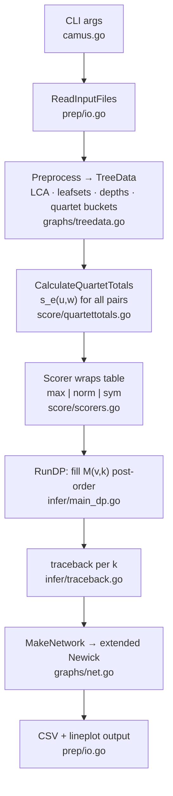

# CAMUS: algorithm flow & structure reference

Companion to `delta_T_report.md`. Maps the full pipeline — CLI → preprocessing → scoring → DP → traceback → network output — to the code. Paper: Willson & Warnow, Bioinformatics 2026, btag245.

## File responsibility

```text
camus/
├── camus.go                      # CLI: flags (l.150-161), main → run → output
└── internal/
    ├── prep/                     # input parsing & preprocessing
    │   ├── io.go                 # ReadInputFiles, CSV + lineplot output
    │   ├── preprocess.go         # Preprocess(): TreeData from constraint + gene trees
    │   └── quartetfilter.go      # quartet filter modes (paper §3.4, threshold t)
    ├── graphs/                   # data structures
    │   ├── treedata.go           # TreeData: LCA table, leafset bitsets, depths, quartet buckets
    │   ├── quartet.go            # Quartet type, topology comparison
    │   └── net.go                # Network, MakeNetwork(), Newick(), Level1() check
    ├── score/                    # edge scoring s_e(u,w)
    │   ├── quartettotals.go      # δ_T = QuartetScore (l.107); s_e = quartetsTotal (l.78)
    │   ├── penalty.go            # CalculateEdgePenalties (norm/sym modes)
    │   ├── scorers.go            # Scorer interface: Maximize / Normalized / SymDiff
    │   └── score.go              # ReticulationScore: post-hoc per-gene-tree support
    └── infer/                    # the DP
        ├── infer.go              # Infer(): driver, InferOptions, DPResults
        ├── main_dp.go            # M[v][k], s(v), s_dp, cycleDP
        ├── helpers.go            # SubtreePre/PostOrder, BestSplit, FourWayBestSplit
        └── traceback.go          # trace structs: recover chosen edges
```

## Top-level call tree

```text
main (camus.go:219)
  parseArgs (camus.go:142)                  # flags l.150-161, positionals l.193-194
  run (camus.go:250)
    prep.ReadInputFiles                      # constraint tree + gene trees
    infer.Infer (infer/infer.go:70)
      prep.Preprocess                        # → gr.TreeData (see below)
      newDP (infer.go:99)
        score.CalculateQuartetTotals         # precompute all s_e(u,w), parallel
      dp.RunDP (main_dp.go:90)               # post-order fill of M[v][k]
      collateResults (main_dp.go:106)        # traceback per k → branch sets
    gr.MakeNetwork(tree, branches).Newick()  # one network per k (camus.go:261)
    prep.WriteDPResultsToCSV / WriteResultsLineplot
```

## Whole-algorithm pseudocode

```text
CAMUS(T, Q):                                   # constraint tree, quartet multiset
  preprocess:                                  # graphs/treedata.go MakeTreeData l.27-51
    LCA table (O(1) lookup), leafset bitsets, depths
    bucket each q ∈ Q at its relevant vertices  # mapQuartetsToVertices l.197

  for every valid pair (u,w):                  # score/quartettotals.go l.43-61
    s_e[u][w] = Σ_q δ_T(q,(u,w))               # Eq. 1; δ_T = QuartetScore l.107
    # valid = w not under u, cycle length > 3, neither is root (ShouldCalcEdge l.63)

  for v in post-order:                         # main_dp.go RunDP l.90, solve l.130
    M[v][0] = M[left(v)][·] + M[right(v)][·]   # no edge targeting v (Eq. 2, first arm)
    for k = 1, 2, ...:                         # reticulation-restriction dimension
      M[v][k] = max( no-edge split of k,
                     s(v,k) )                  # scoreAddEdgeK l.178 (Eq. 3)
      stop when score stops improving

  backtrack from M[root][k] for each k         # traceback.go; collateResults l.106
  return networks N_1..N_m                     # MakeNetwork per branch set (net.go:31)
```

## s(v): edge-target scoring (Eq. 3-5)

```text
scoreAddEdgeK(v, k)                            # main_dp.go:178
  scoreEdgesDown(v, ...)                       # u = v case (Eq. 5), l.212
    for w in SubtreePreOrder(v):               # candidate w below v
      s_e(v,w) + M[w] + cycle-path sums        # via cycleDP + FourWayBestSplit
  for u in SubtreePostOrder(v):                # Pairs(v) enumeration, helpers.go:9
    scoreEdgesAcross(v, u, otherSide, ...)     # u ≠ v case (Eq. 4), l.249
      for w in other child subtree:
        s_e(u,w) + M[u] + M[w]
        + vCycleDP.scores[u] + vCycleDP.scores[w]   # Σ over cycle nodes x of
                                                    # M[off-cycle child of x]
  tie-break: prefer smaller cycle              # bestCycleLen l.186-203
```

`cycleDP.update` (main_dp.go:40-72) builds the path sums incrementally: walking down from v, each node on the would-be cycle contributes its *off-cycle* child's M value — exactly the Eq. 4/5 sum over x ∈ γ_(u,w). `BestSplit`/`FourWayBestSplit` (helpers.go:51-110) split the k reticulation budget across the 2-4 independent pieces (knapsack-style).

## δ_T(q,(u,w)): is quartet q satisfied by edge above (u,w)?

```text
QuartetScore(q, u, w, v, wSub)                 # quartettotals.go:107
  exactly one taxon of q below w?  else Qdiff
  for each taxon t of q:
    cycleNode[t] = LCA of t with u-side or w-side of cycle
  any two taxa share a cycle node? → Qdiff     # degenerate placement
  bestTaxa = taxon attaching closest to the reticulation (by depth)
  bestTaxa == q's own neighbor of the below-w taxon?
    yes → Qeq   (δ_T contributes multiplicity NumQuartet(q))
    no  → Qneq  (δ_T = 0)
```

## Data flow



## Traceback structure

```text
DP.traceback(k) (main_dp.go:291)              # start at Traceback[root][k]
  noCycleTrace   → recurse left/right          # no edge targeted here
  cycleTrace     → emit Branch{u,w}            # a reticulation edge
      wDownTrace / uDownTrace                  # below-w / below-u subproblems
      pathU / pathW → cycleTraceNode.traceUp   # walk cycle, collect off-cycle traces
```

`collateResults` (main_dp.go:106-127) runs this for k = 1..optimal → `branches[k-1]`, so the CLI emits one network per reticulation count (paper §2.4, Reticulation Restriction — a matrix, not a separate mode).

## Complexity (paper §2.3, matches implementation)

- Preprocessing: O(n²); each δ_T evaluation O(1) after it
- Total DP: O(n²(|Q| + n)); with restriction matrix O(n²(|Q| + m³n)), m ≪ n in practice
- Memory: O(n⁴) worst case (quartet storage)

## Score modes (`-sm` flag, scorers.go)

| Mode | CalcScore | Notes |
|---|---|---|
| `max` (default) | raw `quartetTotals[u][w]` | paper's s_e |
| `norm` | count / (NGTree · penalty) | penalty.go |
| `sym` | 2·count − α·penalty·NGTree | `-a` sets α |

`-asSet` counts unique quartet topologies (1 each) instead of multiset multiplicities.
